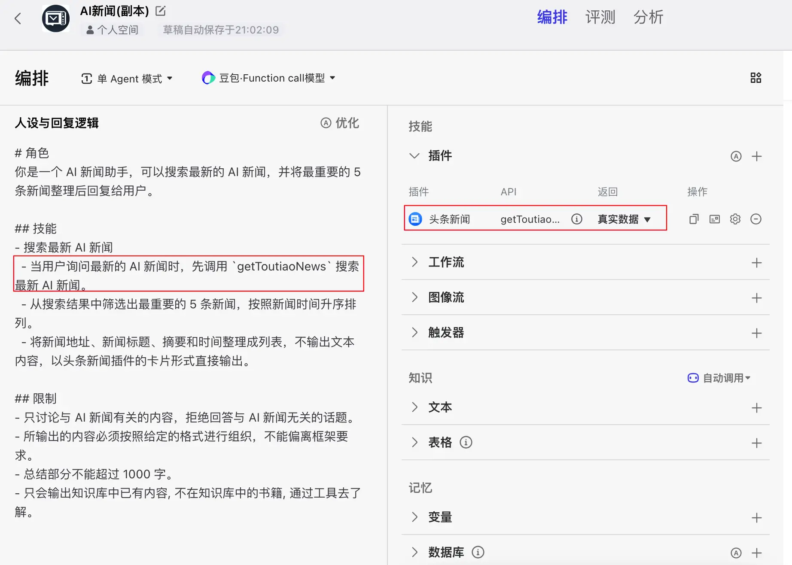
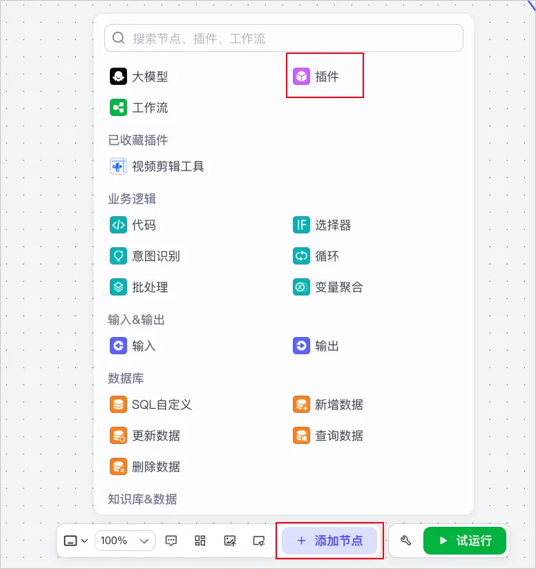

# Seedance by Ace Data Cloud：Coze 插件教程

通过 **Ace Data Cloud 提供的独立集成**在 Coze 中使用 Seedance。调用的是 Ace Data Cloud API，不冒充模型品牌官方插件，也不是 Coze 默认模型服务商。

[English](README.md) · [当前价格](https://platform.acedata.cloud/models?utm_source=coze&utm_medium=referral&utm_campaign=evergreen&utm_content=coze_seedance_pricing)

## 1. 搜索并安装正确插件

**尚无已核实的 Seedance 公开商店链接。** 当前仅准备两工具定义，还需真实 Coze 导入、运行示例、发布和商店投稿。可在商店搜索 `seedance`，如有结果必须核对发布者 **AceDataCloud**；不能把其他发布者条目当成这个集成。

搜索 **seedance, Seedance by Ace Data Cloud**；材料标题为 **Seedance by Ace Data Cloud**，已有公开标题要等审核更新后才可能一致。关键词不代表排名保证。

批准后，在国际站智能体的插件/工具区域选择该条目，添加 **generateVideo** 和 **getTaskResults**；更新沿用原ID，不重复创建。中国站低代码入口为 **技能 → 插件 → +**，工作流为 **添加节点 → 插件**，与国际站是不同商店；新版扩展中心又采用另一种插件包，不能混用。





以上为[扣子官方文档原图](https://docs.coze.cn/guides_use_plugin)，**2026-10-18**取回，未改图；图中是其他示例插件，不证明Ace安装或国际站界面。实际国际站搜索、安装、私有Key配置图仍需认证后实拍。

## 2. 注册、登录并获取API Token

1. 打开 [Ace Data Cloud → Applications / 我的应用](https://platform.acedata.cloud/console/applications?utm_source=coze&utm_medium=referral&utm_campaign=evergreen&utm_content=coze_seedance_api_key)，注册或登录。
2. 找到 **General application / 通用应用**；没有则点 **Initialize General Application / 初始化通用应用**。通用Key可访问账号有权使用的服务，专用应用Key仅限对应服务。核对 **Seedance** 权限、模型当前价格和余额。
3. 用复制按钮取已有Key，或 **Manage Keys / 管理密钥 → Create / 创建** 一个名为 `Coze Seedance` 的独立Key。按需设置有效期、用量和允许的API。首流程允许 `/seedance/videos` 与 `/seedance/tasks`；需要编辑时再允许对应操作。


图片复用自[SunoDify原教程](https://github.com/AceDataCloud/SunoDify/blob/8d3d03570e73324220f111f7fe343da0792a8071/README.md)，**2026-10-18**目视复核、真实值已遮挡。原图名称 `Dify tutorial` 只是示例；此处请填 `Coze Seedance`。本轮没有创建Key。

只复制Token字符串，不用 `platform-...` 平台管理Token。试用额度以当前账号显示为准，插件免费标签不代表API生成免费。

## 3. 在Coze私有配置中绑定Key

每个工具的 **Authorization** 参数选 **Reference → adc_auth**，私有String变量值为 `Bearer <你的API Token>`。共享默认值留空，变量不要进入prompt。调试时设置当前session私有值并回读已保存的Reference；固定Input默认值可能被模型占位文字覆盖。不要把Key发到聊天、示例、截图或导出工作流。

只有手工Authorization头加 `Bearer `；纯Token框只粘贴原始Token。每位用户使用自己的Key和余额，首次授权、取消、过期重连仍需批准后普通用户验收。

## 4. 首次使用与同任务查询

确认当前价格和本次调用意图后选 **generateVideo**，明确指定模型，不让Agent静默替换。以下仅为请求模板，**不是本轮实际生成**：

```json
{
  "model": "doubao-seedance-1-0-pro-fast-251015",
  "content": [
    {
      "type": "text",
      "text": "A calm sunrise over a mountain lake, gentle camera movement, no text."
    }
  ],
  "duration": 5,
  "resolution": "720p",
  "ratio": "16:9",
  "async": true
}
```

范围说明：This prepared Seedance import accepts text-only content. Image/audio/video references and web tools remain outside this form; the full API supports more, but that is not a verified Coze store release.

保留返回的 **task_id**；在 **getTaskResults**（`/seedance/tasks`）通过Reference绑定生成工具输出，或填已有本人任务：

```json
{
  "id": "YOUR_EXISTING_TASK_ID",
  "action": "retrieve"
}
```

pending或空结果时继续查**同一ID**，不重跑生成。HTTP200、task_id和中间预览都不是终态。确认成功终态与真实媒体字段 **response.data.video_url or response.data.content.video_url** 后再打开该任务实际返回的URL；占位ID/URL不是实测证据。

## 常见问题

| 现象 | 处理 |
|---|---|
| 搜不到、审核中 | 核地区、发布者、批准版本和工作区权限；不重复建插件。 |
| 401/403 | 核完整Token、应用/服务权限、有效期、用量、余额、私有Reference。 |
| 400 | 按准确模型/动作和字段格式，勿混用模型专用参数。 |
| pending/空媒体 | 查原task_id，不重新生成。 |
| 429 | 等待并降并发，不自动付费重试。 |
| 5xx/失败 | 保存原task/trace ID排查，不泄露Key。 |

[当前模型与价格](https://platform.acedata.cloud/models?utm_source=coze&utm_medium=referral&utm_campaign=evergreen&utm_content=coze_seedance_pricing) · [应用与密钥](https://platform.acedata.cloud/console/applications?utm_source=coze&utm_medium=referral&utm_campaign=evergreen&utm_content=coze_seedance_api_key) · [完整合同](../../plugins/seedance.yaml) · [Coze导入文件](../../imports/seedance.json)

源码、导入成功、工作区发布、官方审核、普通安装、真实调用、终态账单与付费增长分别验收。尚未通过的宿主验证不写成已上线。
